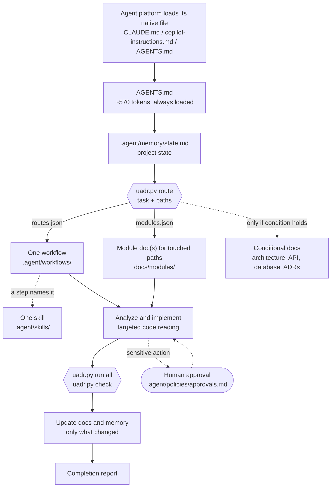

# Framework architecture

UADR separates three things that are usually mixed together:

| Layer | Location | Answers | Owner |
| --- | --- | --- | --- |
| Operating rules | `AGENTS.md`, `.agent/` | How does an agent work here? | Framework (rarely changes) |
| Project knowledge | `docs/` | What is this system? | Project (changes with the code) |
| Automation | `.automation/` | How are rules enforced and tasks run? | Framework plus project commands |

## Context flow



Solid arrows are always taken; dotted arrows are conditional. Nothing below `AGENTS.md` is loaded unless the router or a workflow step asks for it.

## Directory structure

```text
AGENTS.md                  Canonical entry point (the only always-loaded file)
CLAUDE.md                  One-line import of AGENTS.md for Claude Code
.agent/
  README.md                Framework map and lifecycle
  routing/routes.json      Task type -> workflow, required docs, skills, approval gate
  routing/modules.json     Source paths -> module doc
  workflows/               15 task procedures, identical nine-section shape
  skills/                  12 techniques in Agent Skills format, loaded on demand
  policies/                Approvals, security, quality, context loading, documentation
  memory/                  state, handover, known issues (small, durable, Git-tracked)
  templates/               Plan, handover, migration report skeletons
  guide/                   Human-facing documentation of the framework (this folder)
  onboarding/              Inventory and migration report; exists only during Mode B adoption
.agents/skills, .claude/skills   Links to .agent/skills for platforms that scan those folders
.automation/
  uadr.py                  Single CLI: route, run, check, audit, new, index, scan, adopt, sync-adapters
  configuration/uadr.json  Project name and mode, project commands, budgets, required files
  scripts/, validation/    Implementation of the commands and the eight quality gates
  tests/                   Self-tests for the automation
docs/
  index.md                 Generated catalogue: every doc, its purpose, when to read it
  templates/               Templates only; never loaded as context
  <area>/                  Real project docs, created on demand from templates
.github/
  copilot-instructions.md  Thin pointer to AGENTS.md
  instructions/, prompts/  Path-scoped pointers and reusable prompts for Copilot
  workflows/uadr-checks.yml, ISSUE_TEMPLATE/, pull_request_template.md
```

Application code keeps whatever layout the project already has or its stack prefers. The framework creates no `src/`, `tests/`, `scripts/`, or `tools/` folders, because empty directories carry no information and an existing repository already has its own.

## Design decisions

- **One entry point, thin adapters.** Every platform-specific file is a pointer of at most 15 lines. The `instructions` gate fails if an adapter grows rules of its own.
- **Routing is data.** `routes.json` and `modules.json` are read by both agents and scripts, so the reading list an agent sees is the same one the audit measures and the gates verify.
- **Docs describe themselves.** Each doc's frontmatter states its purpose and when to read it; `docs/index.md` is generated from that, so the catalogue cannot drift.
- **Absent is allowed.** A route may name a doc that has not been written. The router says so and the agent proceeds from code. This is what makes incremental adoption possible.
- **Workflows versus skills.** A workflow is the procedure for a task type and is always loaded for that task. A skill is a technique shared by several workflows and is loaded only at the step that needs it.
- **Honesty is mechanical.** `uadr.py run` prints `not run (not configured)` for missing commands, so "tests passed" can only be reported when a test command exists and exited zero.
- **No dependencies.** Automation is Python standard library only and makes no assumption about the project's language.

## Extending the framework

| To add | Do |
| --- | --- |
| A task type | Add a workflow with the nine sections, add a route in `routes.json` |
| A skill | Add `.agent/skills/<name>/SKILL.md` with `name` and `description`, reference it from a route |
| A doc type | Add `docs/templates/<name>.template.md` with `target`, `purpose`, `read_when`, `status` |
| A module | `python3 .automation/uadr.py new module <name> --paths <glob>` |
| An agent platform | Add a pointer file and list it under `adapters.instruction_files` in `uadr.json` |
| A project gate | Set the command in `uadr.json` `commands`; it runs locally and in CI through `uadr.py run` |

Run `python3 .automation/uadr.py check` and `python3 .automation/uadr.py audit --check` after any change to the framework.
