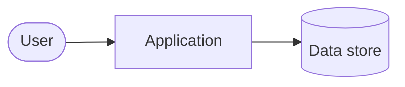

# Architecture overview

<!-- Fill from verified sources. Delete sections that do not apply. Mark gaps `UNKNOWN:` and inferences `ASSUMPTION:`. Remove this comment when done. -->

## System context

<!-- What the system is, its users, and the external systems it talks to. -->

## Components

| Component | Responsibility | Location | Module doc |
| --- | --- | --- | --- |

## Diagram

## Technology stack

| Concern | Technology | Version | Notes |
| --- | --- | --- | --- |
| Language and runtime | | | |
| Framework | | | |
| Data store | | | |
| Build and packaging | | | |
| Test | | | |
| Hosting | | | |

## Design patterns and conventions

<!-- Only patterns the code consistently follows: layering, dependency direction, error handling, configuration. -->

## Architectural constraints

<!-- Rules a change must not break, each with its reason or ADR. -->

## Cross-cutting concerns

| Concern | Where implemented |
| --- | --- |
| Authentication and authorisation | |
| Configuration | |
| Logging and error handling | |
