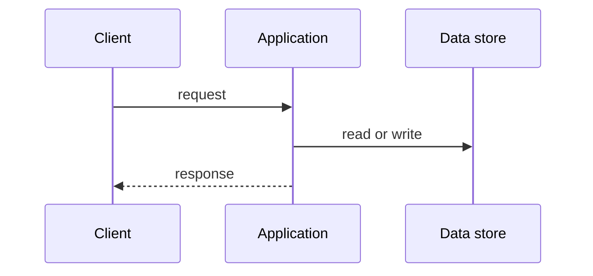

# Data flow and integrations

<!-- Fill from verified sources. Delete sections that do not apply. Mark gaps `UNKNOWN:` and inferences `ASSUMPTION:`. Remove this comment when done. -->

## Key flows

<!-- One subsection per important flow. Name the entry point and each hop with its path. -->

### Flow: <name>

## External integrations

| System | Direction | Protocol | Purpose | Code location | Failure behaviour |
| --- | --- | --- | --- | --- | --- |

## Trust boundaries

<!-- Where untrusted data enters and where authorisation is enforced. -->

## Data ownership

| Data | Owning module | Other readers |
| --- | --- | --- |
